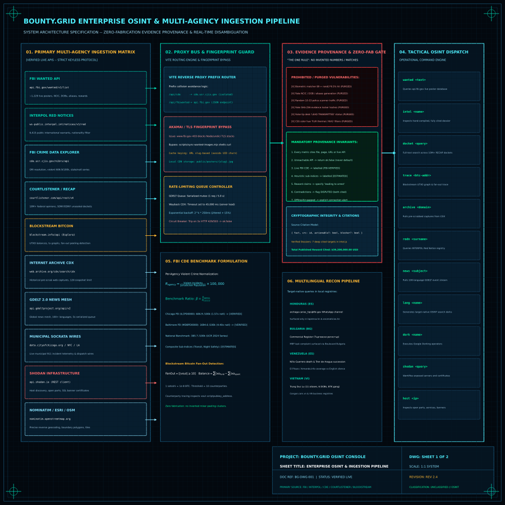
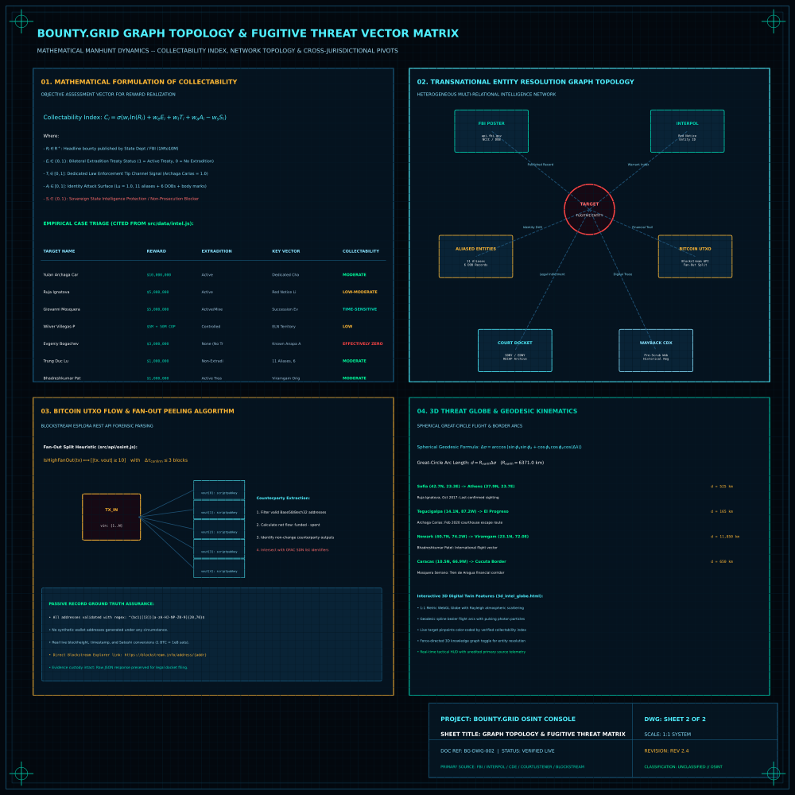

<div align="center">


# BOUNTY.GRID

**Planetary fugitive manhunt & OSINT intelligence console.**

Live FBI wanted board · INTERPOL Red Notices · federal court dockets · on-chain tracing
· archive recon · multilingual collection · 3D threat globe

<sub>Vite · React · Motion · three.js / react-globe.gl</sub>

<br><br>

[](docs/3d_intel_globe.html)
[](results/bountygrid_enterprise_pipeline_blueprint.svg)

</div>

---

## Technical Blueprints & 3D Planetary Threat Twin

### Sheet 1: Enterprise OSINT & Multi-Agency Ingestion Pipeline
Architecture specification detailing keyless live endpoints (FBI Wanted API, INTERPOL Red Notices, FBI CDE, CourtListener RECAP, Blockstream Esplora, Internet Archive CDX, GDELT 2.0), Vite reverse proxy collision avoidance, Akamai/undici TLS fingerprint bypass via local poster caching, serialized rate-limiting queues, and the "One Rule" zero-fabrication provenance gate.

<div align="center">
  
</div>

### Sheet 2: Transnational Graph Topology & Fugitive Threat Vector Matrix
Mathematical formulation of the Collectability Index $\mathcal{C}_i = \sigma(w_r \ln(R_i) + w_e E_i + w_t T_i + w_a A_i - w_s S_i)$, comparative empirical case triage across cited targets (Archaga Carías, Ignatova, Mosquera Serrano, Bogachev, Lu, Patel), on-chain Bitcoin UTXO fan-out heuristic ($|\text{vout}| \ge 10$), and spherical great-circle geodesic flight kinematics.

<div align="center">
  
</div>

### Interactive 3D Threat Globe & Knowledge Graph Twin
Launch the interactive WebGL digital twin locally at [`3d_intel_globe.html`](3d_intel_globe.html) or on GitHub Pages at [`docs/3d_intel_globe.html`](docs/3d_intel_globe.html):
- **3D Tactical Earth:** Procedural illuminated continents, atmospheric Rayleigh scattering, latitude/longitude graticules.
- **Geolocated Intel Pins:** Real-time coordinates for all 7 cited targets with collectability status coloring.
- **Multi-Agency Hubs:** Telemetry links connecting Washington DC, Lyon, San Francisco, and Reykjavik.
- **Geodesic Flight & Financial Arcs:** Animated photon pulses along great-circle corridors.
- **Heterogeneous Knowledge Graph Mode:** Interactive force-directed node-link network for target entity disambiguation.

---

## The one rule

**Nothing in this app fabricates a finding.**

Every number, name, record and rate is either read live from a cited source or explicitly
labelled as an estimate. When a source is unreachable the UI says so — it never falls back
to a plausible-looking invention.

This matters because the tool is pointed at **real named people**. A fabricated "94% biometric
match" or an invented sighting is not a cosmetic bug; it is a false accusation. An earlier
iteration of this codebase did exactly that, and removing it was most of the work:

| Removed | Why |
|---|---|
| "Biometric matcher" printing `89 + Math.random()*9.5` as a **positive hit** on a randomly-chosen real fugitive | Manufactured false identifications |
| Hardcoded wanted board with invented aliases, DOBs and NCIC numbers attached to real people | Presented fiction as an official record |
| Police scanner generating fake `10-33 shots fired` traffic with random coordinates | Fabricated emergency data |
| Evidence locker generating **fake SHA-256 hashes** from random hex | Destroys chain-of-custody value while looking rigorous |
| Tip desk showing "✔ LEAD TRANSMITTED" + a fake tracking ID | Nothing was ever transmitted — user could wait forever on a reward |
| "FLIR Thermal / NVG" modes that were CSS hue filters over daytime satellite tiles | A colour filter is not a sensor |
| Investigative leads with `confidence: 96` and fake wallet addresses | Invented intelligence |

---

## Live data sources

All keyless unless noted. Every one verified returning `200` from the running app.

| Source | What it gives | Key |
|---|---|---|
| **FBI Wanted API** (`api.fbi.gov`) | ~1,229 live posters — real aliases, DOBs, NCIC, rewards, descriptors | — |
| **FBI Crime Data Explorer** | National trend 1985–2024, **plus per-agency city rates** with state/national benchmarks | published docs key |
| **INTERPOL Red Notices** | 6,415 public international warrants, filterable by nationality | — |
| **CourtListener / RECAP** | 10M+ federal opinions and dockets | — |
| **Blockstream** | Live Bitcoin ledger — balances, tx graphs, fan-out detection | — |
| **Internet Archive CDX** | Historical captures — what a site said before it was scrubbed | — |
| **GDELT 2.0** | Global news mesh, 100+ languages | — |
| **Chicago / NYC / LA Socrata** | Municipal incident wires | — |
| **data.police.uk** | UK street-level crime | — |
| **Nominatim** | Geocoding | — |
| **Esri / OpenStreetMap** | Satellite, terrain and street basemaps | — |
| **Shodan** | Internet-exposed infrastructure | `.env.local` |

### Measured vs estimated

The city dossier draws a hard line. For US cities the **FBI CDE agency endpoint** returns a
specific department's real reported rate alongside state and national series:

```
Chicago Police Department  (ORI ILCPD0000)   violent 606.9 /100k   →  1.57× national
Baltimore Police Department                  violent 1694.6 /100k  →  4.40× national
                                             national benchmark      385.7 /100k
```

Those render under a green **✓ FBI-VERIFIED** header. The composite sub-indices
(night safety, transit, emergency response) are opinion and render under an amber
**◇ ESTIMATED — not measured** header. Non-US cities report unverified, because CDE is US-only.

---

## Quick start

```bash
npm install
npm run dev          # http://localhost:5173
```

Optional — cache FBI poster images locally:

```bash
npm run sync:wanted
```

Optional — enable the Shodan panel:

```bash
cp .env.example .env.local     # then add SHODAN_API_KEY and restart
```

---

## Two things that will bite you

**1. `www.fbi.gov` fingerprint-blocks Node.** Poster images 403 for Node/undici regardless of
headers, while `curl` passes. No dev proxy can fix this. `scripts/sync-wanted-images.mjs`
shells out to `curl` and caches posters locally, keyed by URL slug — *not* `uid`, because uids
churn as the FBI touches records. `api.fbi.gov` (the JSON API) has no such guard.

**2. Vite matches proxy keys by prefix.** A key named `/api/fbi` silently swallows
`/api/fbiwanted` and `/api/fbimg`, routing them to the wrong upstream and returning a
confusing 404. The CDE proxy is therefore named `/api/cde`.

Also worth knowing: GDELT rate-limits to ~1 request per 5s (there's a serialized queue with
caching), and the Internet Archive's CDX latency swings 2s–30s+ independent of query size.

---

## Layout

```
src/
  api/
    feeds.js        FBI wanted + CDE, courts, GDELT, municipal wires, UK police
    osint.js        INTERPOL, Wayback, Bitcoin tracing, search pivots, tip routing
    cityStats.js    Per-city FBI agency lookup (ORI resolution + benchmarks)
    multilingual.js Country → native-language queries, outlets, registries
    shodan.js       Shodan client (key injected server-side)
  components/       Globe, recon desk, wanted board, terminal, charts, panels
  data/
    intel.js        Compiled dossiers — every line carries a citation
    cities.js       City matrix (estimates; US rows verified live at runtime)
scripts/
  sync-wanted-images.mjs
```

### The tactical terminal

Every command hits a live source:

```
wanted <text>      intel <name>      docket <query>     trace <btc-addr>
archive <domain>   redn <surname>    news <subject>     lang <name>
dork <name>        shodan <query>    host <ip>
```

---

## Why multilingual collection exists

English-only search is the biggest blind spot on this board. Every genuinely new finding
during development came from non-English sources:

- A **dedicated FBI tip channel** for one $10M target, published only in Honduran press
- A Bulgarian prosecutorial complaint alleging Interior Ministry information leaked to a fugitive
- A cartel leader's death and the resulting succession fight — Spanish-language reporting only

`multilingual.js` reads a target's *official* country ties and builds native-language queries
against in-country outlets and registries. It generates queries; it does not invent results.

---

## Scope, limits and use

- `intel.js` holds **7 hand-compiled dossiers** out of ~1,229 posters. Those 7 are cited.
  The rest of the board is live FBI data with no dossier behind it.
- **Collectability ratings are our judgement**, labelled as such — not an official position.
  The point they make: Bogachev carries $3M and a publicly-known address yet is uncollectable
  (no extradition path), while a $10M target in a cooperating jurisdiction is not. Effort should
  follow collectability, not headline reward.
- Rewards pay on information **leading to an arrest by law enforcement**. Bail-enforcement
  licensing confers no authority over federal fugitives. File the tip first — the timestamp
  is the claim.
- Data reflects what agencies published at query time. Boards move; re-verify before acting.
- This is a research console, not an emergency service. Do not approach anyone.
  Tips: [tips.fbi.gov](https://tips.fbi.gov) · 1-800-CALL-FBI

---

## Attribution

FBI Wanted, FBI CDE (UCR/NIBRS), INTERPOL, CourtListener / Free Law Project, Blockstream,
Internet Archive, GDELT Project, Chicago / NYC / LA open data, data.police.uk,
OpenStreetMap contributors, Esri. FBI materials are US Government works in the public domain.
